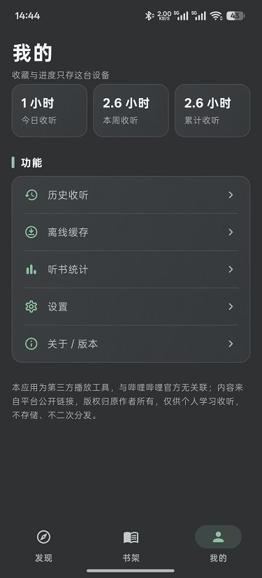
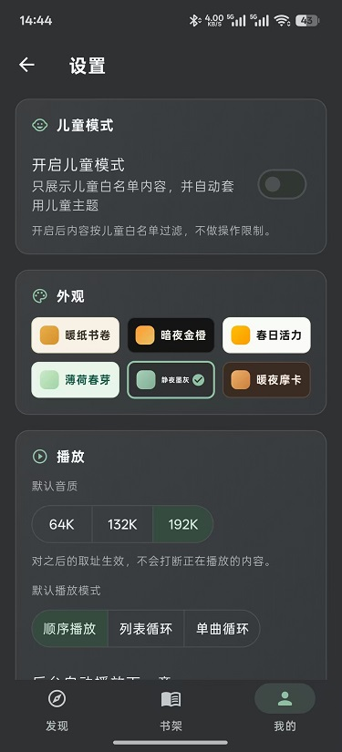

# kele-audio

**基于 B 站内容的 Flutter 安卓有声听书应用**

把 B 站当作"听书库"：有声小说、评书、相声、讲书、音乐……点开即听；一键切换儿童模式，给孩子一个绘本与儿歌的世界。

> 当前版本 **v1.0.0**：规划功能已全部实现，可按下方说明构建 APK 安装使用。

## 简介

kele-audio 是一款**免登录、无广告、专注收听**的第三方听书播放器：

- 🔓 **免登录**：不登录即可浏览、收藏、收听、记录进度；
- 🎧 **专注收听**：章节连播、断点续播精确到秒、倍速播放、睡眠定时、后台播放与锁屏控制；
- 🧒 **儿童模式**：一键切换儿童向界面与白名单内容（绘本 / 儿歌 / 童话 / 睡前故事），操作方式与平时无异；
- 📚 **结构化收听**：发现页按类型浏览，书架收藏在听内容，"我的"记录收听统计。

## 功能

### 内容发现

- **发现页**：推荐 / 有声书 / 相声曲艺 / 讲书 / 音乐 / 播客 / 英语听力七大分类，双列卡片信息流，下拉刷新、触底分页；分类 Tab 切换保留滚动位置与已加载内容；
- **编辑精选**：首页专题 Banner（可在高级设置中隐藏），点击直达对应搜索结果；
- **搜索**：关键词搜专辑，本地搜索历史（最近 10 条，可单删/清空），请求节流防风控；
- **专辑详情**：章节目录（长列表懒加载、正序/倒序切换）、播放全部、单集点播、逐章进度标记（未听 / 在听 x% / 已听完）、简介展开收起、收藏、整本缓存；
- **断网兜底**：分类首页本地缓存，断网或接口异常时可继续浏览缓存内容并给出提示。

### 播放

- **播放控制**：播放/暂停、上一章/下一章、进度条拖拽 seek（精确到秒）、章节目录抽屉点章起播；
- **倍速**：0.5x–3.0x（常用档 0.75 / 1 / 1.25 / 1.5 / 2.0）；
- **睡眠定时**：关闭 / 5 / 10 / 15 / 30 / 45 / 60 分钟 / 本章结束，播放页顶部实时倒计时徽标；
- **播放模式**：顺序播放 / 列表循环 / 单曲循环；
- **后台与锁屏**：后台播放、锁屏与通知栏控制、线控/蓝牙耳机按键；音频焦点处理（来电打断自动暂停、挂断恢复、拔耳机暂停）；
- **断点续播**：播放中定时落盘进度，冷启动自动回到上次的专辑、章节与秒级进度，跨章续播；
- **地址自愈**：播放地址过期（403/超时）自动重新取址并 seek 回原位，不中断收听；
- **MiniPlayer**：全局迷你播放条（封面进度环、播放/暂停、关闭），页面切换不丢失。

### 书架与历史

- **书架**：「在听」置顶区（进度条 + 一键续播）+ 收藏列表；排序（最近收听 / 收藏时间 / 标题）；左滑删除（可撤销）、长按多选删除；空态引导跳转发现页；
- **历史收听**：按今天 / 昨天 / 日期分组，单条删除（可撤销）、清空（二次确认）、点击续播。

### 离线缓存

- **缓存能力**：整本缓存 + 单章缓存（串行下载队列），暂停 / 继续、单集删除、整本删除、全部清理；
- **离线播放**：断网可播已缓存内容（Android 本地文件 / Web 端 blob）；播放时优先命中本地缓存；「仅播放已缓存」门禁开关；
- **管理页**：总占用与任务列表、下载状态与进度、按专辑分组管理。

### 听书统计

- 本周 / 本月 / 累计收听时长、累计听完专辑数（「我的」页含今日收听摘要）；
- 近 14 天收听趋势、最常听分类 Top3、最常听专辑 Top5；
- 数据由本地播放日志聚合，**不上传**。

### 儿童模式

- 一键开关（关闭走二次确认防误触）：儿童向界面主题 + 白名单内容过滤（绘本 / 儿歌 / 童话 / 睡前故事 / 科普）；
- 白名单过滤：正向特征词 + 成人向否决词 + 时长门槛，配置支持远端覆盖，附人工终审流程；
- 仅切换主题与内容，**不做**操作限制；书架、历史、播放功能与平时一致。

### 外观与设置

- **主题**：六套完整皮肤（含深色），即时换肤、重启保留；进入儿童模式自动套用儿童默认皮肤；
- **播放偏好**：默认音质（64K / 132K / 192K）、默认播放模式、后台自动播放下一章、本章结束即停；
- **下载与缓存**：「仅 Wi-Fi 下载」偏好开关、清除图片缓存；
- **高级设置**：编辑精选显隐、发现页分类显隐（「推荐」固定显示）。

### 账号绑定与同步

- **B 站账号**（可选）：App 扫码绑定，解锁高音质音源；登录态仅存本机，可随时解绑，收藏与收听记录不受影响；
- **WebDAV 云同步**（可选）：手动「备份到云端 / 从云端同步」，同步设置、书架、历史与进度、收听统计（整体覆盖式）；兼容坚果云等标准 WebDAV 网盘，凭据仅存本机。

### 数据与隐私

- 收藏、历史、进度、统计、设置**全部本地存储**，无需注册，不上传服务器；
- 播放地址只存内存、不落库；除用户主动发起的 WebDAV 备份外无任何对外数据传输。

## 界面预览

以下截图来自应用实际运行画面（暗色为静夜墨灰主题，另含儿童模式）：

| | | |
|:---:|:---:|:---:|
|  |  |  |
| **发现**：按类型浏览有声书、相声曲艺、讲书、音乐、播客等精选内容 | **儿童模式**：一键切换儿童向界面与白名单内容（绘本 / 儿歌 / 童话 / 睡前故事） | **播放**：章节连播、倍速、睡眠定时，断点续播精确到秒 |
|  |  |  |
| **书架**：在听与收藏列表，自动记录最近收听进度 | **我的**：今日 / 本周 / 累计收听时长统计，历史收听与离线缓存入口 | **设置**：儿童模式一键开关、六套主题外观、音质与播放模式选择 |

## 技术

- **Flutter**（仅 Android，API 26+）
- 内容源：B 站公开 Web 接口（WBI 签名、DASH 音频流），**不自建后端**
- 播放内核：`media_kit` + `audio_service`

## 运行方式

环境要求：Flutter 3.38.x（Dart 3.13.5+）、JDK 17、Android SDK。

```bash
# 安装依赖
flutter pub get

# 连接 Android 设备/模拟器后运行
flutter run

# 以 Web（Chrome）方式运行，便于快速调试预览
flutter run -d chrome

# 构建 release APK
flutter build apk --release
```

> 注：项目平台范围仅 Android（API 26+），Web/Chrome 仅用于调试预览。

### Web 预览（浏览器调试）

浏览器有 CORS 限制且禁止设置 UA/Referer 等「禁止头」，无法直连 B 站接口，必须走本地反代 `tool/dev_proxy.mjs`（静态托管 `build/web` + 反代 `/api/*`、`/audio`、`/img`）。

**启动步骤：**

1. 启动反代（首次需要，之后可保持常驻）：

   ```powershell
   node tool/dev_proxy.mjs          # 默认 http://localhost:8088
   ```

   想换端口：`$env:PORT=9000; node tool/dev_proxy.mjs`

   判断是否已在运行：访问 `http://localhost:8088/__health`，返回 `ok` 即已启动，跳过此步。

2. 改过 `lib/` 代码后重新构建（反代无需重启，它按请求实时读 `build/web`）：

   ```powershell
   flutter build web --release
   ```

3. 浏览器访问 **http://localhost:8088**。

**常见问题：**

| 现象 | 原因 | 解决 |
|---|---|---|
| 「加载失败 / WBI 密钥获取失败」 | 用 `flutter run -d chrome` 启动，页面跑在 Flutter 自带端口，绕过了反代 | 改走 `http://localhost:8088`（见上方启动步骤） |
| 接口 502 / 请求失败 | 网络问题，反代转发不到 B 站 | 查看 dev_proxy 终端的 `[api] FAIL` 日志，检查本机网络 |
| 页面仍是旧内容 | `build/web` 未重新构建 | `flutter build web --release` 后刷新浏览器 |

日常预览不要用 `flutter run -d chrome`；`flutter run -d windows` 调试原生逻辑可以（原生端直连，不走反代）。

## 文档

| 文档 | 说明 |
|---|---|
| [docs/PRD.md](docs/PRD.md) | 产品需求文档（功能详述、风险清单、验收标准） |
| [docs/milestones.md](docs/milestones.md) | 里程碑计划与完成记录（M0~M8） |
| [docs/theme.md](docs/theme.md) | UI 主题风格方案 |
| [AGENT.md](AGENT.md) | 开发指引（工程约定） |

## 免责声明

本应用为第三方个人开发的播放工具，与哔哩哔哩官方无任何关联或背书。应用内所有音频、封面、文字等内容均来自第三方平台的公开链接，版权归原作者及相关权利人所有。本应用不存储、不修改、不二次分发任何内容，仅供个人学习与收听使用。

## 开源协议

MIT 开源协议。

## 致谢

本项目引用与依赖了以下第三方项目，谨致谢意：

### 参考项目

| 项目 | 用途 |
|---|---|
| [abts（阿B听书）](https://github.com/fengqiao57/abts)（MIT 协议） | 技术选型与核心逻辑参考：`media_kit` 取流播放、WBI 签名与风控节流、断点续播、离线缓存等实现对照 |
| [bilibili-API-collect](https://github.com/SocialSisterYi/bilibili-API-collect) | B 站 Web 接口社区逆向文档，WBI 签名算法与 DASH 音频流接口的对接依据 |

### 开源依赖

| 项目 | 用途 |
|---|---|
| [Flutter](https://flutter.dev) | 应用开发框架（Android 目标） |
| [media_kit](https://pub.dev/packages/media_kit) + [media_kit_libs_audio](https://pub.dev/packages/media_kit_libs_audio) | 播放内核（libmpv），支持带 UA/Referer 的 HTTP 取流 |
| [audio_service](https://pub.dev/packages/audio_service) | 后台播放、锁屏/通知栏媒体控制 |
| [dio](https://pub.dev/packages/dio) | HTTP 客户端（B 站接口请求） |
| [provider](https://pub.dev/packages/provider) | 状态管理 |
| [go_router](https://pub.dev/packages/go_router) | 路由导航 |
| [shared_preferences](https://pub.dev/packages/shared_preferences) | 本地键值存储（收藏/进度/设置等 JSON 数据） |
| [crypto](https://pub.dev/packages/crypto) | WBI 签名哈希计算 |
| [cached_network_image](https://pub.dev/packages/cached_network_image) | 封面图加载与内存/磁盘缓存 |
| [flutter_cache_manager](https://pub.dev/packages/flutter_cache_manager) | 图片磁盘缓存管理（设置页清除缓存） |
| [path_provider](https://pub.dev/packages/path_provider) | 离线缓存音频文件目录 |
| [web](https://pub.dev/packages/web) | Web 端 IndexedDB 访问（离线缓存） |
| [qr_flutter](https://pub.dev/packages/qr_flutter) | 扫码登录二维码渲染 |
| [cupertino_icons](https://pub.dev/packages/cupertino_icons) | iOS 风格图标 |
| [flutter_lints](https://pub.dev/packages/flutter_lints) | 静态检查规则（开发期） |
