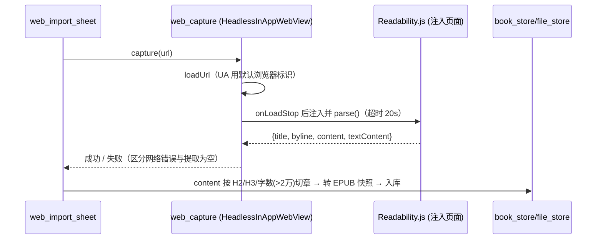

# M9 阅读与听书 · 技术设计

> 阅读前提：先读 `docs/reader-plan.md`（选型决策 D1~D8）与 `AGENT.md`（项目硬性约束）。
> 本文档是实现阶段的唯一技术依据；与代码实现冲突时，以代码评审结论更新本文档。

## 1. 目录结构规划

遵循现有分层：`features/` 只做 UI 与页面状态，通用能力收敛 `core/services/`，领域模型放 `core/domain/`。

```text
lib/
├── features/reader/                      # 阅读模块 UI
│   ├── reader_entry_page.dart            # 本地书列表（书架分组复用）与添加入口
│   ├── reader_page.dart                  # 阅读页（WebView 容器 + 工具栏）
│   ├── reader_controller.dart            # 阅读会话状态（ChangeNotifier，provider）
│   ├── reader_settings_sheet.dart        # 排版设置面板（字号/行距/边距/模式/主题）
│   ├── web_import_sheet.dart             # 粘贴链接导入弹窗（输入/进度/错误态）
│   └── tts_control_bar.dart              # 听书控制条（朗读中段落跳转/启停）
├── core/domain/
│   └── reader_book.dart                  # ReaderBook / ReaderChapter / TtsConfig 模型
└── core/services/
    ├── reader/
    │   ├── book_store.dart               # 书籍元数据存储（shared_preferences JSON）
    │   ├── book_file_store.dart          # 书籍文件落盘（books/{id}/book.epub）
    │   ├── txt_importer.dart             # TXT：编码识别 → 清洗 → 切章
    │   ├── txt_to_epub.dart              # 章节 XHTML → 轻量 EPUB（archive 打包）
    │   ├── epub_importer.dart            # EPUB 校验 + 拷贝落盘
    │   ├── web_capture.dart              # 隐藏 WebView 抓取 + Readability.js 注入
    │   ├── web_article_importer.dart     # 正文 → 切章 → 快照 EPUB
    │   └── reader_bridge.dart            # WebView ↔ Dart 桥协议封装
    └── tts/
        ├── tts_engine.dart               # 引擎抽象（接口 + TtsVoice/TtsParams）
        ├── tts_engine_system.dart        # flutter_tts
        ├── tts_engine_edge.dart          # edgetts-dart 合成 + media_kit 播放
        ├── tts_engine_http.dart          # 自定义 HTTP TTS URL 模板
        ├── tts_session.dart              # 段落队列/逐段播放/高亮回调/进度
        └── tts_settings_store.dart       # 引擎/音色/语速/模板持久化

assets/reader/
├── index.html                            # WebView 入口页（内嵌桥接脚本）
├── foliate-js/                           # vendored（MIT）
└── readability/Readability.js            # vendored（Apache-2.0）
```

新依赖与版本锁定见 `docs/reader-plan.md` §5.1；pubspec.yaml 中各依赖行尾加 `# M9` 注释（与现有注释风格一致）。

## 2. 数据模型与存储

### 2.1 ReaderBook（`core/domain/reader_book.dart`）

| 字段 | 类型 | 说明 |
|---|---|---|
| `id` | String | 雪花/时间戳生成，同时作为文件目录名 |
| `title` / `author` | String | TXT 取文件名/空；EPUB 与网页由 WebView 内解析回传 |
| `source` | enum | `localTxt` / `localEpub` / `webArticle` |
| `originUrl` | String? | 网页书专有，用于「重新抓取」 |
| `fileName` | String | 落盘 EPUB 文件名 |
| `chapterCount` | int | 章节数 |
| `coverPath` | String? | EPUB/网页封面（网页书用站点 favicon 或省略） |
| `addedAt` / `lastReadAt` | DateTime | 排序用 |
| `lastChapterIndex` / `lastFraction` | int / double | 阅读进度（fraction 为章内 0~1） |
| `lastTtsParaIndex` | int? | 听书断点（章内段落序号） |
| `removed` | bool | 软删除（与现有书架左滑撤销一致） |

### 2.2 存储约定（沿用 shared_preferences JSON 风格）

| key | 内容 |
|---|---|
| `reader_books` | `List<ReaderBook>` JSON |
| `reader_progress_{id}` | 进度详情（cfi、段落断点等细粒度数据） |
| `reader_typography` | 排版设置（字号/行距/边距/翻页模式/主题覆盖） |
| `reader_history` | 阅读活动记录（bookId/章节名/方式 阅读\|听书/时间），历史页「阅读」分组数据源 |
| `reader_log` | 阅读时长埋点（date/bookId/durationSec/方式），统计页「阅读时长」数据源 |
| `tts_settings` | 引擎类型、音色、语速、音调、HTTP 模板列表 |

书籍文件：`path_provider`getApplicationDocumentsDirectory()`/books/{id}/book.epub`。删除书籍时同步删目录。

### 2.3 备份集成

`core/services/backup/backup_service.dart` 增加 `reader_books`、`reader_progress_*`、`reader_typography`、`tts_settings` 四组数据；**书籍文件本身不进备份**（体积不可控），还原后缺文件的条目在书架显示「文件缺失」态并提供重新导入。导入弹窗覆盖确认文案同步补此项。

## 3. 导入管线（M9.1）

### 3.1 TXT 导入器

1. **编码识别**：BOM 检测（UTF-8/UTF-16）→ UTF-8 严格解码，失败回退 GBK（`fast_gbk`）；两者皆失败按 Latin1 兜底并在导入结果中提示乱码风险；
2. **清洗**：去除站点水印行、连续空行归一为段间一个空行；
3. **章节切分**：正则按优先级匹配（`^\s*第[0-9一二三四五六七八九十百千万零两]+[章卷节回部].*$`、`^\s*Chapter\s+\d+`、`^\s*序章|楔子|番外`）；切出章节数 < 3 时视为无章节文本，按每章约 5000 字兜底切分；
4. **转 EPUB**：每章生成 XHTML（`archive` 打包 mimetype/container.xml/content.opf/toc），统一交 foliate-js 渲染——**渲染与 TTS 管线因此无需感知来源格式**；
5. 落盘 + 元数据入库 + 结果回执（成功条数/编码/章节角标）。

单元测试覆盖：GBK/UTF-8 双编码样本、无章节长文本、超长章节、含大量空行的脏文本。

### 3.2 EPUB 导入器

- 校验 zip 头（`PK\x03\x04`）防扩展名伪造；整文件拷贝落盘，不做解包解析；
- 书名/作者/封面由阅读页首次打开时 WebView 内 foliate-js 解析回传后补写元数据（见 §4 桥协议 `onBookMeta`）。

### 3.3 网页文章导入器



要点：

- URL 校验仅接受 `http(s)`；站点跳转后的最终 URL 写回 `originUrl`；
- **失败重试 1 次**（含短暂延时）；提取正文为空（反爬页/登录墙/非文章页）与网络失败分开提示，提供「用 WebView 打开手动确认」入口；
- content HTML 保留 `` 远程引用（阅读视图可看图），TTS 侧天然只取文本；`<script>/<style>` 一律剥离；
- 快照生成后与源网页无依赖，离线可读；「重新抓取」走同一管线覆盖旧快照，保留进度。

## 4. 阅读页（M9.2）

### 4.1 WebView 加载链路（M9.0 spike 定版）

首选方案：`InAppWebView` 通过 `loadFlutterAsset('assets/reader/index.html')` 加载入口页，foliate-js 作为相对路径 ES module 引入。**若 Android WebView 对 asset 相对路径 module 加载受阻**（spike 验证点），降级为 rollup 把 foliate-js 打成单文件 bundle 后 `loadData` 内嵌。该结论写入本文档并同步 milestones。

### 4.2 JS ↔ Dart 桥协议（`reader_bridge.dart` 统一封装，页面代码禁止散落调用）

| 方向 | 消息 | 载荷 |
|---|---|---|
| Dart→JS | `loadBook` | `{ name, base64(epub) }` |
| Dart→JS | `openAt` | `{ cfi? / chapterIndex+fraction }` |
| Dart→JS | `setStyle` | `{ fontSize, lineHeight, margin, theme tokens, mode: paged|scroll }` |
| Dart→JS | `highlightParagraph` / `clearHighlight` | `{ paraIndex }` |
| Dart→JS | `requestToc` / `requestParagraphs` | `{ chapterIndex }` |
| JS→Dart | `onReady` / `onBookMeta` | meta: `{ title, author, cover(dataURL) }` |
| JS→Dart | `onRelocated` | `{ chapterIndex, fraction, cfi }`（节流 2s 落盘） |
| JS→Dart | `onToc` / `onParagraphs` | 目录项 / 当前章段落文本数组 |
| JS→Dart | `onTapCenter` | 呼出/收起工具栏 |

### 4.3 阅读体验

- **翻页/滚动**：foliate-js `paged`/`scroll` 双模式；paged 模式使用其内置翻页动画（覆盖/平移）；
- **排版**：字号/行距/边距/字重可调并持久化（`reader_typography`），设置面板样式对齐现有 bottom sheet 组件；
- **主题**：把 `app_tokens` 当前皮肤色板映射为 CSS 变量注入（`setStyle`），阅读页自动跟随六套皮肤与儿童模式默认皮肤；夜间跟随皮肤自带深色；
- **目录**：底部抽屉（对齐播放页章节目录交互），支持正序/倒序；
- **进度**：`onRelocated` 节流落盘；冷启动从书架进入自动 `openAt` 续读；
- **Web 降级**：`kIsWeb` 时阅读页显示「阅读功能请在 Android 端使用」占位（与项目「Web 仅调试预览」定位一致）。

## 5. TTS 听书（M9.3）

### 5.1 引擎抽象

```dart
abstract class TtsEngine {
  String get id;                                  // system / edge / http
  Future<List<TtsVoice>> listVoices();            // 供设置页选择（http 档可为空列表）
  Future<void> start(TtsParams params);           // 语速/音调/音色
  Future<void> speak(String text);                // 单段合成并播放
  Future<void> stop();                            // 丢弃合成队列并停止播放
  bool get isSpeaking;
  Stream<TtsEvent> get events;                    // done / error / progress
  Future<void> testConnection();                  // 设置页连通性自检（edge/http 档）
  Future<void> dispose();
}
```

三档实现要点：

- **system**：`flutter_tts`；`setLanguage(zh-CN)`、`setVoice`、`setSpeechRate`（0.5~3.0 映射到平台速率）、`setPitch`；段落完成靠 `completionHandler`；
- **edge**：`edgetts-dart` WebSocket 合成 mp3 片段，经**独立 media_kit Player 实例**播放（不与 B 站播放共用 `PlayerService`，避免状态互踩）；预合成下一段（队列深度 2）消除段间停顿；
- **http**：URL 模板支持占位符 `{text}`（URL 编码）、`{voice}`、`{rate}`，支持配置自定义请求头；响应为音频流直接交播放层；模板管理支持多条（增删改 + 试听）。协议设计参考 legado「在线朗读引擎」，仅借鉴 URL 约定，不参考其代码。

### 5.2 段落管线（`tts_session.dart`）


- 段落断点 `lastTtsParaIndex` 随进度落盘，再次进入可从断点续听；
- 用户手动翻页/跳章时 TTS 同步切换到新位置（先 stop 再重取段落）；
- 阅读页退出但 TTS 继续在后台运行（见 §5.3），再次进入阅读页恢复高亮同步。

### 5.3 audio_service 集成与互斥

- 复用 `core/services/player/audio_service_bridge.dart`：TTS 会话注册为媒体会话（title=书名，chapter=当前章），获得后台播放、锁屏/通知栏控制、线控/蓝牙按键、睡眠定时（复用现有实现）；
- **互斥规则**：启动 TTS 前先停止 B 站播放；B 站播放启动前先停止 TTS；互斥收敛在一处（新增 `PlaybackArbiter`，player_service 与 tts_session 均通过它申请播放权），避免两处各自判断；
- 音频焦点沿用现有自建 MethodChannel 方案（`audio_focus.dart`），TTS 视为普通媒体播放参与打断/恢复。

## 6. 设置页（M9.4）

`settings_page.dart` 新增「本地书 · 听书」分组：

- 听书引擎选择（系统 / Edge / 自定义 HTTP）；
- 系统引擎：音色列表（flutter_tts `getVoices` 过滤 zh）+ 语速/音调滑杆；
- Edge 引擎：音色列表（内置常用 zh 音色清单 + 动态获取）+ 语速/音调 + 「连通性自检」+ 每个音色试听按钮；
- HTTP 引擎：模板列表管理（增删改 + 试听）；
- 默认行为：进入书籍默认「阅读」或「继续听书」。

## 7. 书架集成与业务闭环（M9.1/M9.2/M9.3 贯穿）

**核心原则：本地书全链路走 `reader_*` 独立数据域，不写 `shelf` / `play_history` / `play_log` 任何一行；现有三条链路（书架 ShelfController、历史 play_history 聚合、统计 play_log 聚合）零改动，闭环靠各展示页「追加分区/分组」完成。**

理由：三条现有链路都是「B 站专辑」语义（album 反查、UP 主、章节完成数），本地书若混入则每个消费点都要加专辑缺失兜底，回归风险高且语义混乱。

### 7.1 书架页布局（`shelf_page.dart` 仅追加，不重构）

```text
书架页
├── PageHeader「书架」  actions: [＋导入(新增)] [选择删除] [排序]
├── 在听置顶区            （现有，零改动，仅 B 站在听内容）
├── ★ 本地书分区（新增）   （无书时整个隐藏）
│     ├── 行卡片 = 封面 + 标题 + 来源角标(TXT/EPUB/网页) + 已读 x/y 章·xx% + 最后阅读时间
│     ├── 默认按最近阅读排序，第一本即「继续阅读」入口（不另做置顶区）
│     ├── 独立排序（最近阅读/导入时间/标题）与多选删除，交互样式复用 _ShelfRow 一套
│     │   （左滑撤销/长按多选），但操作对象是 ReaderBookStore，与 ShelfController 互不感知
│     └── ＋导入弹层：导入本地文件（file_picker） / 导入网页链接（web_import_sheet）
└── 收藏列表              （现有，零改动；空态文案不动，导入引导由 PageHeader ＋导入承担）
```

不混入收藏列表：语义不同（收藏 vs 拥有）、字段不同（无 UP 主、进度口径不同）、排序合并互相干扰。

### 7.2 闭环数据流

| 环节 | 机制 |
|---|---|
| 进度 | `reader_progress_{id}`（cfi/fraction/段落断点）为细粒度真源；`ReaderBookStore` 元数据冗余 `lastReadAt / lastChapterIndex / fraction` 供书架列表同步直读；阅读页 `onRelocated` 节流（2s）同步元数据并 `notifyListeners` → 书架实时刷新（机制对齐现有 `notifyProgressChanged`） |
| 历史 | `reader_history` 按天记 `bookId / 章节名 / 方式(阅读\|听书) / 时间`；历史页在「收听历史」上方追加「阅读」分组（条目带方式图标），点击续读；现有收听历史聚合零改动 |
| 统计 | `reader_log`（date/bookId/durationSec/方式）驱动统计页新增「阅读时长」卡（本周/累计，静读与 TTS 分开计数）；**不并入收听统计**——「收听」语义保持纯净，也避免统计页把本地书当专辑反查 |
| 删除 | 软删除 + SnackBar 撤销（对齐现有书架交互）；确认删除后才清理文件目录、进度、历史、日志；备份还原后缺文件显示「文件缺失」态 |

`ReaderBookStore`（ChangeNotifier）是独立于 `ShelfController` 的第二个书域控制器：books 列表、进度元数据、历史、时长日志都由它持有；书架/历史/统计页各自 watch 或读它，二者无任何耦合。

### 7.3 隔离措施清单（「不影响现有听书」的验收依据）

| 层 | 措施 |
|---|---|
| 数据 | 不动 `LocalDatabase` 六张表与既有 shared_preferences key；新数据全部 `reader_*` 前缀 |
| 播放 | TTS 用独立 media_kit Player 实例；`PlaybackArbiter` 统一互斥；`audio_service` 同一时刻只注册一个媒体会话 |
| UI | 播放页 / MiniPlayer / 发现页零改动；TTS 不进 MiniPlayer（阅读页自带控制条 + 通知栏控制） |
| 路由 | 新增 `/reader/:id` 独立路由，不进 album_detail / player 链路 |
| 回归 | M9.1 / M9.3 准出含「既有测试零回归 + 书架/播放手测冒烟」 |

## 8. 测试策略

| 层级 | 覆盖 |
|---|---|
| 单元测试（`test/`） | 编码识别、章节切分（各正则分支 + 兜底）、TXT/网页 → EPUB 打包、URL 模板渲染、ReaderBook 序列化、ReaderBookStore（进度元数据同步/软删撤销/历史与日志聚合）、备份键覆盖 |
| 桥协议测试 | reader_bridge 消息编解码（mock WebView channel） |
| 真机验收 | 按 `docs/reader-milestones.md` 各阶段准出清单逐条实测；截图存 `docs/shortscreen/`（命名 `m9-*.png`） |
| 回归 | 每阶段收尾跑既有 17 个测试文件确保零回归；书架/播放手测冒烟（在听区、收藏、历史、统计四点不变化） |

## 9. 代码借鉴与合规

- anx-reader（MIT）：`reader_bridge` 消息协议设计、foliate-js 集成方式、TXT 编码处理可参考其实现，拷贝处文件头注释标注 `// Adapted from anx-reader (MIT)`；
- foliate-js（MIT）与 Readability.js（Apache-2.0）：vendored，保留原许可证文件于各自目录内；
- README「致谢 · 参考项目」表与关于页许可列表须登记上述三项；`docs/release-notes.md` M9 版本按「新增功能」分类撰写（面向使用者的功能描述，不含实现细节）。
